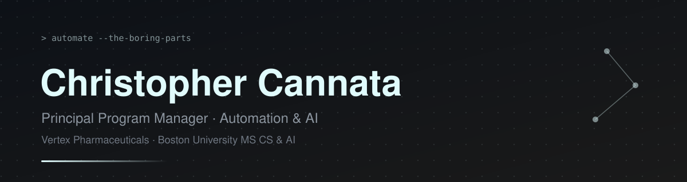

  

## About Me

- 🏢 Principal Program Manager, Automation & AI at Vertex Pharmaceuticals
- 🎓 M.S. in Computer Science & AI at Boston University
- 🤖 Building AI agents and automation that eliminate manual work at enterprise scale
- 🛠️ Currently: agentic workflows, RAG systems, and Jira automation
- 🎯 Automate the boring parts. Ship the useful parts.

## Languages & tools I Have Placed My Hands On

## GitHub Status

## Best Repositories

| Repository | What it is | Language |
| --- | --- | --- |
| [HinghamWeatherBot](https://github.com/Chraken/HinghamWeatherBot) | Taught myself API requests in Python and scheduled Lambda functions in AWS | Python |
| [NHLPlayoffPrediction](https://github.com/Chraken/NHLPlayoffPrediction) | Predictive model for NHL playoff teams using current standings data | Python |
| [BUMSCS](https://github.com/Chraken/BUMSCS) | Repository for my master's program at BU | Java |

## Tech Stack

## Favorite Quote

> "You'll have bad times, but it'll always wake you up to the good stuff you weren't paying attention to."
>
> — Sean Maguire, *Good Will Hunting*

## Contribution Heatmap

## My Coding Journey

I didn't start as an engineer. I started in finance — a B.S. from CU Boulder, then KPMG and Deloitte, where I spent my days inside enterprise systems, migrations, and financial reporting. The work that stuck with me wasn't the decks. It was the moments I could automate something away: a reconciliation script here, a reporting workflow there, hours of manual effort gone.

That pull turned into a career. At Amazon I ran program work across financial automation, at Rapid7 I built AI into finance systems, and today at Vertex I lead automation and AI programs — agentic workflows, RAG systems, Jira automation — while I'm back in school for an M.S. in CS & AI at BU to go deeper on the technical side.

I still think like a PM: start from the manual work, find the highest-leverage thing to automate, and ship it. The code is how I get there now.
